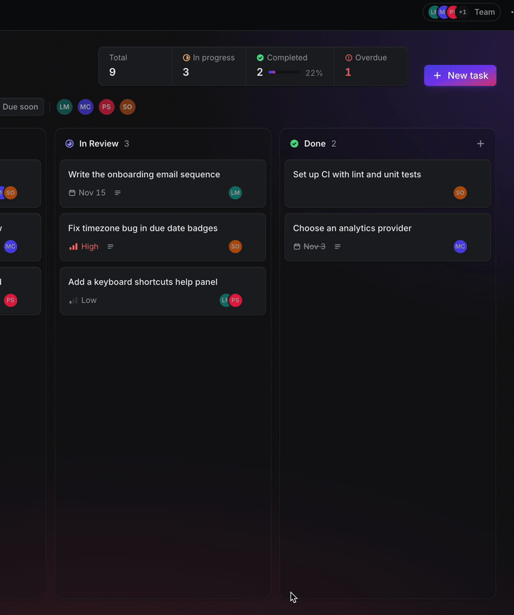

# Playbook

A Linear-inspired Kanban board for small teams. Drag tasks across To Do, In Progress,
In Review and Done, assign teammates, and track what changed. Every visitor gets a private guest board, so no sign-up necessary.

**Live:** https://nick-task-board.vercel.app

## Features

- Drag and drop between and within columns (mouse, touch and keyboard)
- Create, edit and delete tasks: title, description, priority, due date
- Due-date badges for overdue, today and due soon
- Stats header: total, in progress, completed %, overdue
- Search plus priority, due-date and assignee filters, saved in the URL
- Team members with multiple assignees and avatars on cards
- Activity timeline on every task ("Moved from To Do → In Progress · 2h ago")
- Sample board on first visit, Clear board, and an editable board name
- Light, dark and system themes, plus a mobile layout with status tabs

## Stack

React, TypeScript, Vite, Tailwind CSS, dnd-kit, Supabase (Postgres, Auth,
RLS), Vercel. Vitest for unit tests.

## Security

- Each visitor gets an anonymous Supabase session, and Row Level Security on
  every table so you only ever see your own rows.
- `user_id` is filled in by the database (`auth.uid()`), never sent by the client.
- The activity log is written only by a Postgres trigger, so the browser can
  read its history but can't fake or delete it.
- Assignments use composite foreign keys, so a task can only be linked to a
  team member owned by the same user.
- Only the public publishable key is in the frontend. No secrets in the repo.

## Run it locally

1. `git clone https://github.com/nick11255/task-board && cd task-board && npm install`
2. Create a Supabase project and turn on **Allow anonymous sign-ins**
   (Authentication → Sign In / Providers).
3. In the SQL Editor, run `supabase/migrations/0001` through `0004`, in order.
4. Copy `.env.example` to `.env.local` and add your project URL and publishable key.
5. `npm run dev`

## Scripts

| Command | What it does |
|---|---|
| `npm run dev` | Start the dev server |
| `npm run build` | Type-check and build |
| `npm run lint` | Lint with oxlint |
| `npm test` | Run unit tests (Vitest) |

## what's next

- I want to use Playbook to run two team projects I’m working on: RateMyHusky and Live Brainstormer (real-time ai meeting app). Although this was for a coding screen, it could genuinely be useful for me.

- **Real accounts:** upgrade a guest to a permanent account without losing their tasks, using Supabase identity linking.
- **Shared boards:** invite teammates to one board, with access based on board membership instead of a single owner.
- **Realtime:** once boards are shared, sync changes live with Supabase Realtime so the whole team sees moves as they happen.
- **GitHub links:** attach PRs to tasks so a card moves when its PR merges.

